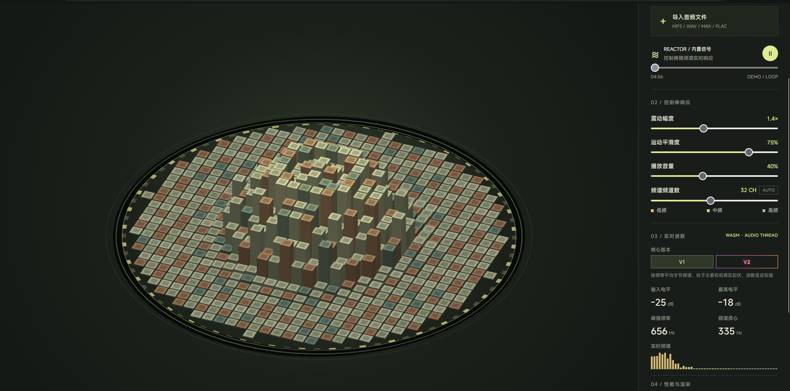
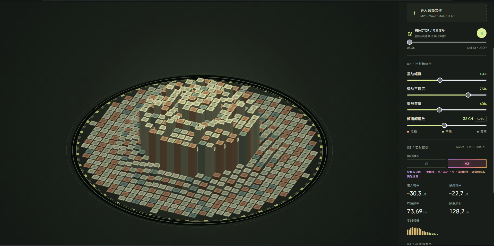
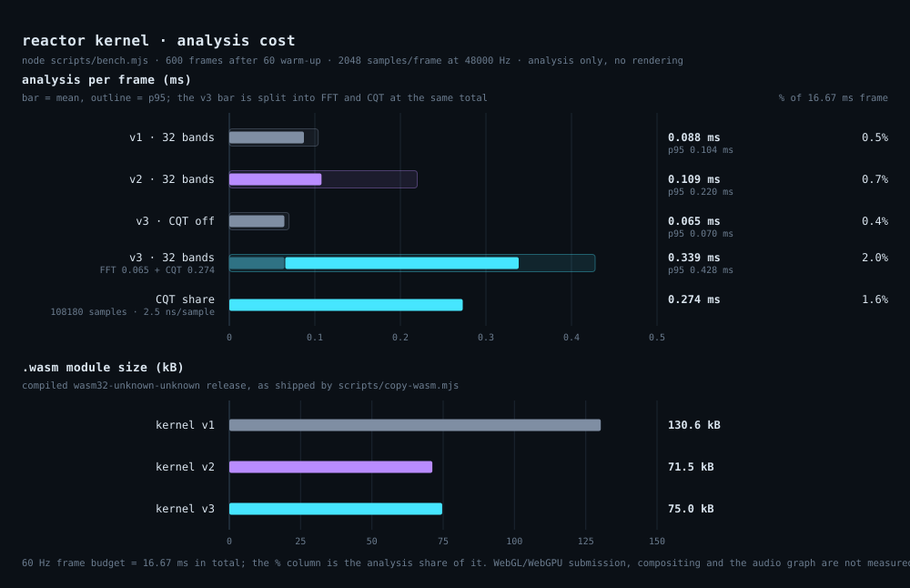

# Reactor Audio Visualizer (WASM)

以切尔诺贝利反应堆堆芯的控制棒阵列为视觉原型的实时音频可视化实验，把频谱分析整条链路搬进了 WebAssembly。

网页在浏览器本机分析音频，将不同频段的能量映射为 709 根控制棒的升降运动。支持演示信号、本地音频文件、麦克风输入、机内声音，以及视角拖动、缩放和灵敏度、平滑度、音量调节。

分析内核有三版，可在面板里切换。v1 用 f32 模仿 Web Audio `AnalyserNode`，可以在 `AudioWorklet` 里运行；v2 是全 f64 的异步管线，读数换成真实的 dBFS / Hz，并把显示曲线调得更强烈；v3 在此基础上把频率轴切开——高频仍交给 FFT，低频（45–428 Hz）换成常数 Q 滤波器组，因为那里 2048 点 FFT 的 23 Hz bin 已经宽过一个频带。v2 与 v3 都是可选的——没有编译就自动禁用，页面继续使用 v1。

## Screenshots



---



---


## Run locally

需要 Node（`^20.19` 或 `>=22.12`）、pnpm、Rust 1.85+（edition 2024），以及 `rustup target add wasm32-unknown-unknown`。

```bash
pnpm install
pnpm run build:wasm        # v1 内核（必需）
pnpm run build:wasm:v2     # v2 内核（可选，不编就没有 v2 按钮）
pnpm run build:wasm:v3     # v3 内核（可选，同上）
pnpm run dev               # http://127.0.0.1:4174
```

生产构建用 `pnpm build`（会先编译 v1 内核）配 `pnpm preview`。三版内核的数学都可以在 Node 里离线验证，不需要浏览器：

```bash
pnpm run check:kernel
pnpm run check:kernel:v2
pnpm run check:kernel:v3
pnpm bench                 # 重新生成本节的图表与数字
```

## Benchmarks

每帧分析开销（`push` + `step`），在 Node 里跑真实的 `.wasm` 测得，不含渲染。图和下面这块数字都由 `pnpm bench` 写出，同一次运行：

<!-- bench:start — 由 node scripts/bench.mjs 生成，勿手改；数字与 docs/bench.svg 同源 -->



| 配置 | 均值 ms | p50 ms | p95 ms | 占 60 Hz 帧 | 模块体积 |
|---|---|---|---|---|---|
| v1 · 32 带，f32 FFT 2048 | 0.088 | 0.084 | 0.104 | 0.5% | 130.6 kB |
| v2 · 32 带，f64 FFT | 0.109 | 0.081 | 0.220 | 0.7% | 71.5 kB |
| v3 · 32 带，FFT + CQT | 0.339 | 0.323 | 0.428 | 2.0% | 75.0 kB |

CQT 占 v3 的 1.6%：13 个 bin、每帧 108,180 个样本、约 2.5 ns/样本。关掉它之后同一份内核是 0.065 ms，与 v2 同档。

<!-- bench:end -->

读法：

- **只算分析。** 渲染（WebGL/WebGPU 提交、合成）和音频图不在其中，60 Hz 的 16.67 ms 预算里它们另占一份。
- **单次运行。** 这个量级逐次抖动 10–20%，足以让 v1、v2 和关掉 CQT 的 v3 互换名次。看比例和量级，不要看第三位小数。
- **换台机器就换一组数。** 比例比绝对值可靠；要对比就自己跑一遍 `pnpm bench`。

完整表格、p50/p95 与 CQT 份额的推导见 [`docs/bench.md`](docs/bench.md)；v2 与 v3 在同一信号上的逐带能量对比见 [`docs/v3-comparison.md`](docs/v3-comparison.md)。

## Notes

This is an audiovisual interaction experiment. It is not a physical simulation of a reactor, and audio is processed locally in the browser.

v2 与 v3 只有编译过才会出现：它们放在 `public/` 而不是走静态 import，页面在运行时抓取并校验 wasm 魔数，`scripts/copy-wasm.mjs` 会删掉过期的旧副本，所以「文件存在」严格等于「编译过」。

三版内核的柱高不可直接比较——v2 与 v3 的显示曲线按设计比 v1 更激进。v2 目前只在主线程运行；`wasm32-unknown-unknown` 上没有时钟也没有可 park 的线程，因此 Tokio 只用到 `sync` 原语，执行器由 JS 逐帧驱动（推导见 `wasm_v2/src/lib.rs` 头部）。

v3 的低频段比高频段最多晚 164 ms：延迟由窗长决定，CQT 窗必须够长才能分开 45–428 Hz 的相邻频带，而那个滞后无法用负 offset 补偿。面板上标了这一点；它是有意的取舍，不是待修的 bug（推导见 `wasm_v3/src/lib.rs` 头部）。

## License

MIT. See [LICENSE](LICENSE).
