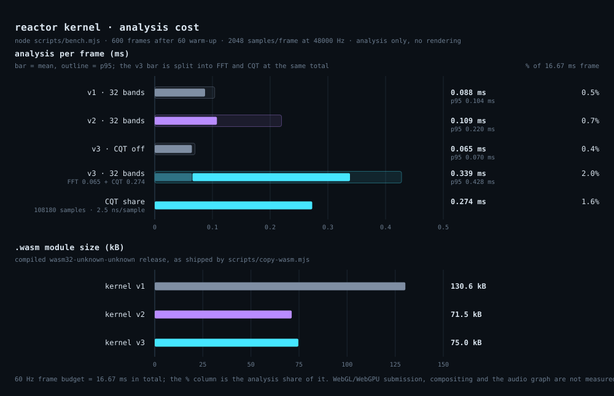

# Analysis cost per frame

Generated by `node scripts/bench.mjs` — 600 frames after 60 warm-up, one
block (2048 samples at 48000 Hz) per frame, no browser, no rendering.

The 60 Hz frame budget is 16.67 ms **in total**; the numbers below are the analysis
share of it. Rendering (WebGL/WebGPU submission, compositing) is not included.

These are single-run figures from one machine. At 0.07–0.36 ms per frame the run-to-run
spread is 10–20% — enough to reorder v1, v2 and the CQT-free v3 row — so read the ratios
and the order of magnitude, not the third digit. The CQT share is the stable number: it is
a difference between two rows measured back to back in the same process.

| configuration | mean ms | p50 ms | p95 ms | % of 60 Hz frame |
|---|---|---|---|---|
| v1 · 32 bands, FFT 2048 | 0.088 | 0.084 | 0.104 | 0.5% |
| v2 · 32 bands, f64 FFT | 0.109 | 0.081 | 0.220 | 0.7% |
| v3 · 4 bands (CQT 0 bins) | 0.065 | 0.064 | 0.070 | 0.4% |
| v3 · 32 bands (CQT 13 bins) | 0.339 | 0.323 | 0.428 | 2.0% |
|   ↳ CQT share: 108180 samples/frame, 2.5 ns/sample | 0.274 | — | — | 1.6% |

The `v3 · 4 bands` row is the same kernel with the CQT switched off by construction:
at 4 bands the derived crossover (`Q fs / N_fft`, with `Q = 4/(rho-1)` and
`rho = 320^(1/4)`) falls below the lowest band centre, so no bin fits and the constant-Q
path does no work. The gap between the two v3 rows is therefore the CQT cost, measured
rather than estimated — and the per-sample figure under it is what decides whether a
wider CQT is affordable.

| kernel | .wasm |
|---|---|
| v1 | 130.6 kB |
| v2 | 71.5 kB |
| v3 | 75.0 kB |

Sizes are after the state was moved out of the data segment: `State::new()` is all-zero
and the non-zero defaults are applied in `rk*_init`, so the large buffers are zero-filled
memory rather than bytes in the file. v3 went from 515.1 kB to the figure above with no
change in behaviour; the three kernel suites are what says so.

The chart above is `docs/bench.svg`, written by the same run as this file, so the bars and
the tables cannot disagree. It is plain SVG with no scripting and no external font: it
opens in any browser and renders in a markdown preview.
